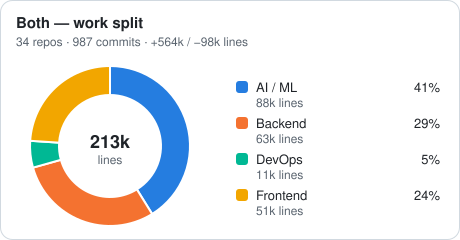
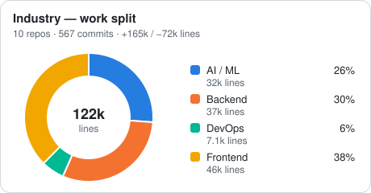
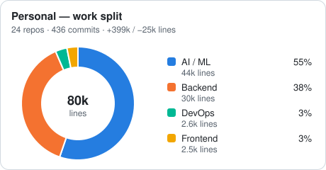
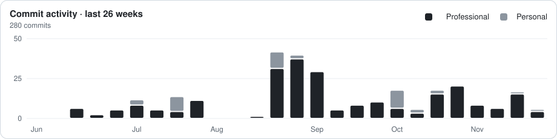

<h1>Hi, I'm Arpnik Singh 👋</h1>

**Software engineer · AI systems, backend, DevOps & frontend**

  
  

- 💼 Built production products at **Knowbie** and **AltConvey**:, AI services, Terraform infra, Node.js & Java APIs, React and Flutter mobile apps.
- 🧠 AI / NLP work: RAG with discourse-unit chunking, discourse segmentation, NL→SQL, agentic assistants, Multi-Agent Systems.
- 🎓 Concordia University, Montréal.

> **980 commits** across **34 repositories**: 10 industry, 24 personal · **35 commits in the last 4 weeks**

## 🧭 What I work on

Every changed file in my commits is classified as **AI / ML**, **Backend**, **DevOps** or **Frontend**, then split into **industry** work (production code at companies) vs **personal** projects. Expand a view below, or [open the interactive dashboard](https://arpnik.github.io/git-tracker/) to toggle areas and click into repos.

<b>🌐 Both</b> · 34 repos · 980 commits · AI / ML 40% · Backend 28% · Frontend 26%

 

| Area | Share | Lines changed | |
|---|--:|--:|---|
| 🧠 AI / ML | 40% | 75,851 | [explore →](https://arpnik.github.io/git-tracker/#scope=all&area=ai) |
| ⚙️ Backend | 28% | 53,654 | [explore →](https://arpnik.github.io/git-tracker/#scope=all&area=backend) |
| 🚀 DevOps | 5% | 10,031 | [explore →](https://arpnik.github.io/git-tracker/#scope=all&area=devops) |
| 🎨 Frontend | 26% | 50,018 | [explore →](https://arpnik.github.io/git-tracker/#scope=all&area=frontend) |

<b>💼 Industry</b> · 10 repos · 544 commits · Frontend 43% · AI / ML 29% · Backend 21%

 

| Area | Share | Lines changed | |
|---|--:|--:|---|
| 🧠 AI / ML | 29% | 31,894 | [explore →](https://arpnik.github.io/git-tracker/#scope=professional&area=ai) |
| ⚙️ Backend | 21% | 23,179 | [explore →](https://arpnik.github.io/git-tracker/#scope=professional&area=backend) |
| 🚀 DevOps | 7% | 7,391 | [explore →](https://arpnik.github.io/git-tracker/#scope=professional&area=devops) |
| 🎨 Frontend | 43% | 47,519 | [explore →](https://arpnik.github.io/git-tracker/#scope=professional&area=frontend) |

<b>🧪 Personal</b> · 24 repos · 436 commits · AI / ML 55% · Backend 38% · DevOps 3%

 

| Area | Share | Lines changed | |
|---|--:|--:|---|
| 🧠 AI / ML | 55% | 43,957 | [explore →](https://arpnik.github.io/git-tracker/#scope=personal&area=ai) |
| ⚙️ Backend | 38% | 30,475 | [explore →](https://arpnik.github.io/git-tracker/#scope=personal&area=backend) |
| 🚀 DevOps | 3% | 2,640 | [explore →](https://arpnik.github.io/git-tracker/#scope=personal&area=devops) |
| 🎨 Frontend | 3% | 2,499 | [explore →](https://arpnik.github.io/git-tracker/#scope=personal&area=frontend) |

## 📈 Activity

**Recently**

- **Nov 26** · [`Arpnik/git-tracker`](https://github.com/Arpnik/git-tracker) · 1 commit · “updated github workflow for main profile” · 🚀 DevOps
- **Nov 19** · [`Arpnik/git-tracker`](https://github.com/Arpnik/git-tracker) · 1 commit · “Update track-stats.yml” · 🚀 DevOps

## 💼 Industry experience

### AltConvey · Software Engineer
React UI, Java REST API, Python AI services and Terraform-managed infrastructure.  
5 repos · 279 commits · AI / ML 37% · Frontend 30% · Backend 24% · DevOps 9%

| Repository | Discipline | Commits | Lines changed |
|---|---|--:|--:|
| `acy-ai-contract` | 🧠 AI / ML | 129 | 54,177 |
| `acy-ai` | 🧠 AI / ML | 50 | 5,833 |
| `acy-ui` | 🎨 Frontend | 44 | 37,028 |
| `acy-rest` | ⚙️ Backend | 37 | 21,042 |
| `acy-materials` | 🧠 AI / ML | 19 | 30,692 |

### Knowbie · Lead Software Engineer
Operator & admin web apps, Flutter end-user app, Node.js backend and CMS.  
5 repos · 265 commits · Frontend 81% · Backend 13% · AI / ML 6%

| Repository | Discipline | Commits | Lines changed |
|---|---|--:|--:|
| `Operators` | 🎨 Frontend | 117 | 26,787 |
| `end-user` | 🎨 Frontend | 73 | 9,405 |
| `knowbie-back` | ⚙️ Backend | 48 | 15,393 |
| `AdminV2` | 🎨 Frontend | 24 | 29,750 |
| `knowbie-cms` | 🧠 AI / ML | 3 | 5,495 |

## 🧪 Projects

| Project | What it is | Discipline | Commits |
|---|---|---|--:|
| ⭐ [**EDU-Chunking-RAG**](https://github.com/Arpnik/EDU-Chunking-RAG) | Retrieval-augmented generation using elementary-discourse-unit chunking. | 🧠 AI / ML | 41 |
| ⭐ [**DISRPT-Segmenter**](https://github.com/Arpnik/DISRPT-Segmenter) | Discourse unit segmentation for the DISRPT shared task. | 🧠 AI / ML | 20 |
| ⭐ **agentic-assistant** | Agentic AI assistant. | 🧠 AI / ML | 15 |
| ⭐ [**FedBN**](https://github.com/Arpnik/FedBN) | Federated learning with local batch normalization. | 🧠 AI / ML | 20 |
| [**SOEN-6441--TubeLytics**](https://github.com/anubhavm101/SOEN-6441--TubeLytics) with anubhavm101 | – | ⚙️ Backend | 64 |
| [**neetcode-submissions**](https://github.com/Arpnik/neetcode-submissions) | My NeetCode.io problem submissions | ⚙️ Backend | 48 |
| **SafeNL2SQL** | A simple approach to use AI-powered agents that translate natural language into data queries | ⚙️ Backend | 39 |
| [**taskd-technical-challenge**](https://github.com/Arpnik/taskd-technical-challenge) | – | ⚙️ Backend | 33 |
| [**SOEN-341**](https://github.com/Arpnik/SOEN-341) | – | ⚙️ Backend | 25 |
| **twin-transformer** with FrancescoBonzi | – | 🧠 AI / ML | 24 |

+ 14 more in the [full stats](https://github.com/Arpnik/git-tracker/blob/main/README_STATS.md) and the [dashboard](https://arpnik.github.io/git-tracker/).

---
🤖 This page regenerates daily from my commit history by [git-tracker](https://github.com/Arpnik/git-tracker) ([how it works](https://github.com/Arpnik/git-tracker/blob/main/docs/HOW_IT_WORKS.md)) · last updated Nov 26, 2026
